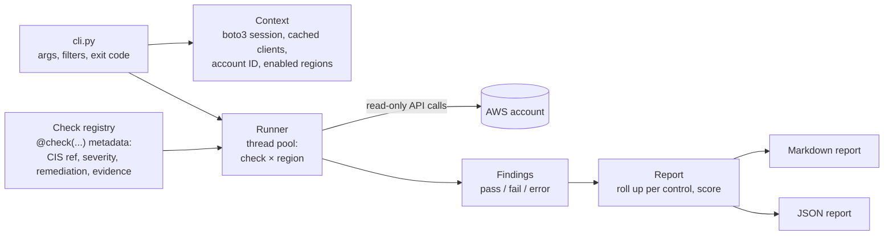

# Cloud Security Posture Checker

A **read-only** command-line tool that audits an AWS account against the **CIS AWS Foundations Benchmark v3.0.0** and writes an assessor-style risk report in Markdown and JSON. Each finding has a severity rating, the affected resources, remediation steps and the evidence behind it.

> Think of it as a third-party risk assessment, but run against a cloud account: assess the control, record the evidence, rate the risk and say how to fix it.


---

## The problem

In third-party risk management (TPRM), a vendor's security is judged through questionnaires and screenshots. That's slow, it's a point-in-time view, and it relies on what the vendor says. In the cloud, most of those controls can be **checked directly through the provider's APIs**. Is root MFA on? Is CloudTrail logging in every region? Is SSH open to the internet?

This tool does that. It asks AWS for the configuration, compares it with the CIS benchmark and writes the kind of report an assessor would hand to a risk owner. Every row in the report shows what failed, why it matters, how to fix it, and which API call produced the evidence.

## What it checks

25 automated checks: 24 from the CIS AWS Foundations Benchmark v3.0.0, plus GuardDuty as an AWS best practice.

| Area | Checks |
|---|---|
| **Identity (CIS 1.x)** | Root access keys (1.4), root MFA (1.5), password length (1.8) and reuse (1.9), MFA for console users (1.10), unused credentials (1.12), one active key per user (1.13), key rotation (1.14), permissions only through groups (1.15), no `*:*` admin policies (1.16) |
| **Storage (CIS 2.x)** | S3 Block Public Access (2.1.4), S3 HTTPS-only bucket policies (2.1.1), EBS encryption by default (2.2.1) |
| **Logging (CIS 3.x)** | Multi-region CloudTrail (3.1), log file validation (3.2), AWS Config (3.3), CloudTrail KMS encryption (3.5), KMS key rotation (3.6), VPC flow logs (3.7) |
| **Monitoring (CIS 4.x)** | Security Hub enabled (4.16) |
| **Networking (CIS 5.x)** | No SSH/RDP from `0.0.0.0/0` (5.2) or `::/0` (5.3), default security groups locked down (5.4), IMDSv2 required (5.6) |
| **Threat detection** | GuardDuty enabled (best practice, not a CIS control) |

Run `posture-check --list-checks` to see every check with its ID, severity and scope.

## Architecture



```
src/posture_checker/
├── cli.py            # entry point: posture-check
├── context.py        # boto3 session, cached clients, region discovery
├── registry.py       # @check decorator, parallel runner, error handling
├── models.py         # Severity, Status, CheckMeta, Finding
├── report.py         # rolls findings into controls; writes Markdown and JSON
└── checks/
    ├── iam.py               # CIS 1.x
    ├── storage.py           # CIS 2.x (S3, EBS)
    ├── logging.py           # CIS 3.x (CloudTrail, Config, KMS, flow logs)
    ├── network.py           # CIS 5.x (security groups, IMDSv2)
    └── threat_detection.py  # Security Hub, GuardDuty
```

Each check is a small generator function. Its control metadata lives right next to the logic:

```python
@check(
    id="iam-root-mfa", cis="1.5", severity=Severity.CRITICAL, service="iam",
    title="MFA is enabled for the root user",
    evidence="iam:GetAccountSummary",
    remediation="Sign in as the root user ... and assign an MFA device.",
)
def root_mfa(ctx):
    if ctx.client("iam").get_account_summary()["SummaryMap"]["AccountMFAEnabled"]:
        yield Result.ok("root", "Root MFA is enabled.")
    else:
        yield Result.fail("root", "Root MFA is not enabled.")
```

## Design decisions

| Decision | Why |
|---|---|
| **Read-only by design.** It only calls `Describe*`, `Get*` and `List*` APIs and needs nothing beyond the AWS-managed `SecurityAudit` policy. | An assessment tool should never change what it assesses. A read-only scope also means a security team can approve it quickly. |
| **"Could not evaluate" is its own status, never a pass.** | In an assessment, missing evidence is a gap, not a pass. If an API call is denied (for example by an SCP or a missing permission), the report lists that control under coverage gaps rather than counting it as compliant. |
| **Every check carries its evidence**, meaning the exact API calls it used. | Findings can be traced and repeated. A reviewer can run the same call and get the same answer, the way audit evidence should work. |
| **Findings roll up to one status per control.** The score is the share of controls that passed. | Risk owners think in controls, not individual resources. Each failed control still lists every affected resource for the people fixing it. |
| **Severity follows likely impact**, not CIS level. Root without MFA is critical. A missing reuse rule is low. | CIS Level 1 and Level 2 describe how hard a control is to adopt, not how much risk it carries. A risk report needs to be prioritised. |
| **Regional checks run in every enabled region, in parallel.** | Attackers use the regions you don't watch. Running checks in parallel keeps a full-account scan fast. |
| **`--fail-on <severity>` exit code.** | The same scan can gate a CI/CD pipeline, turning a point-in-time assessment into a continuous control. |
| **Tests run against [moto](https://github.com/getmoto/moto)**, a simulated AWS. | The checks are tested against real API response shapes, with no AWS account and no cost. |

## Quick start

```bash
git clone https://github.com/ayerokun-cmd/cloud-posture-checker.git
cd cloud-posture-checker
python -m venv .venv && source .venv/bin/activate   # Windows: .venv\Scripts\activate
pip install -e .

# Uses your normal AWS credentials. The SecurityAudit managed policy is enough.
posture-check --profile audit --output-dir reports
```

Useful options:

```bash
posture-check --regions us-east-1,eu-west-1        # limit the regions scanned
posture-check --min-severity high                   # only high and critical checks
posture-check --checks iam-root-mfa,cloudtrail-multi-region
posture-check --format json --fail-on high          # for CI: exit code 2 on high/critical failures
```

Exit codes: `0` scan finished, `2` a control at or above `--fail-on` failed, `1` could not reach AWS.

### Required permissions

Attach the AWS-managed **`SecurityAudit`** policy to the role or user that runs the scan. The tool makes no write calls.

## Sample report

[`docs/sample-report.md`](docs/sample-report.md) is a full report generated against a **simulated** account (moto) that was set up with common misconfigurations. A short excerpt:

> **Posture score: 32.0%** of evaluated controls passed (8 passed, 17 failed, 0 could not be evaluated).
>
> | Severity | Failed controls | Affected resources |
> |---|---:|---:|
> | Critical | 1 | 1 |
> | High | 4 | 5 |
> | Medium | 9 | 14 |
> | Low | 3 | 4 |
>
> **Top risks**
> 1. **CRITICAL**: MFA is enabled for the root user (CIS 1.5, 1 resource)
> 2. **HIGH**: MFA is enabled for every IAM user with a console password (CIS 1.10, 1 resource)
> 3. **HIGH**: No attached customer-managed policy allows "\*:\*" administrative access (CIS 1.16, 1 resource)
> 4. **HIGH**: S3 Block Public Access is enabled (account-wide or on every bucket) (CIS 2.1.4, 1 resource)
> 5. **HIGH**: No security group allows SSH or RDP from 0.0.0.0/0 (CIS 5.2, 2 resources)

Each failed control then gets its own section listing the affected resources, the remediation and the evidence:

> **[HIGH] CIS 5.2: No security group allows SSH or RDP from 0.0.0.0/0**
>
> | Resource | Region | Detail |
> |---|---|---|
> | `sg-281ff018593b92912 (legacy-bastion)` | us-east-1 | Allows 0.0.0.0/0 on port(s) 22. |
> | `sg-cdc8a13131b5112aa (legacy-bastion)` | eu-west-1 | Allows 0.0.0.0/0 on port(s) 22. |
>
> **Remediation:** Remove the 0.0.0.0/0 rule for ports 22 and 3389. Use Systems Manager Session Manager, or restrict the rule to known admin IP ranges.
>
> **Evidence:** `ec2:DescribeSecurityGroups`

## Running the tests

```bash
pip install -e ".[dev]"
pytest
```

## Roadmap

- [ ] Remaining automatable CIS v3.0.0 controls (IAM Access Analyzer, S3 MFA Delete, RDS encryption, NACLs)
- [ ] Multi-account scans through AWS Organizations and an assumed role
- [ ] Map each finding to NIST CSF 2.0 and ISO 27001:2022 controls
- [ ] HTML report and a trend view comparing scans over time
- [ ] Suppressions file for accepted risks, with an owner and an expiry date (like a risk register)

## License

MIT
